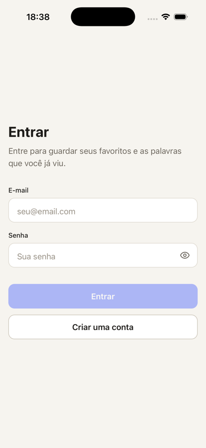
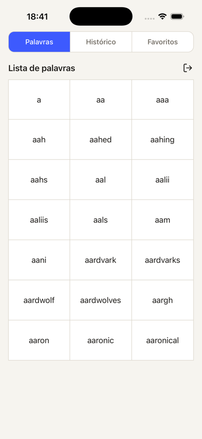
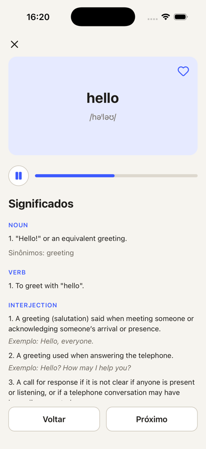
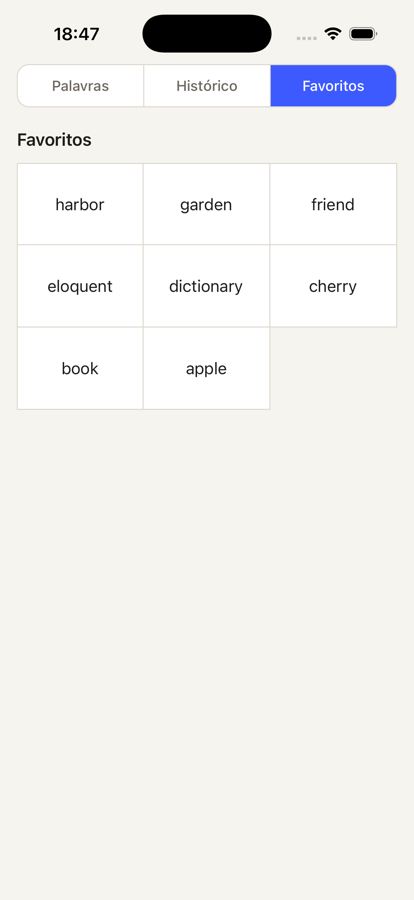

# Dicionário de Inglês

App mobile para navegar pelas palavras em inglês, ver significado, fonética e pronúncia, e guardar favoritos e histórico por usuário.

> This is a challenge by [Coodesh](https://coodesh.com/)

<p>
  
  
  
  
</p>

## Tecnologias

- **React Native 0.86** com **Expo SDK 57**, em TypeScript
- **React Navigation** (stack nativa e abas no topo)
- **Uniwind** (Tailwind CSS no React Native) com `tailwind-variants` para os presets dos componentes
- **TanStack React Query** para dados remotos, com o cache salvo em **MMKV**
- **Zustand** para o estado do login
- **Supabase**: autenticação por e-mail e senha, e Postgres com RLS para a lista de palavras, favoritos e histórico
- **Free Dictionary API** para significados, fonética e áudio
- **expo-audio** e **expo-speech** para a pronúncia
- **Reanimated** para a barra de progresso do áudio
- **react-hook-form** com **zod** nos formulários
- **Jest** com **React Native Testing Library**, e **GitHub Actions** rodando os testes em todo pull request

## Funcionalidades

Obrigatórias:

- Lista de palavras com rolagem infinita, 21 por página, em grade de 3 colunas como no wireframe
- Tela da palavra com fonética, significados agrupados por classe gramatical, exemplos e sinônimos, e os botões Voltar e Próximo
- Favoritar e desfavoritar
- Histórico das palavras vistas, da mais recente para a mais antiga
- Cache das requisições: uma palavra já vista abre na hora, mesmo depois de fechar o app

Diferenciais:

- Áudio da pronúncia com play, pausa e barra de progresso
- Testes unitários e de componentes, com CI no GitHub Actions
- Login com e-mail e senha, com favoritos e histórico ligados ao usuário

## Como rodar

### Requisitos

- Node 24 e pnpm 11
- Xcode com um simulador de iOS, ou Android Studio com um emulador
- O app usa módulos nativos (MMKV, áudio), então roda como build de desenvolvimento, não no Expo Go

### Passos

```sh
git clone https://github.com/Fabiano-Bragaaa/coodesh-test.git
cd coodesh-test
pnpm install
```

Crie o arquivo `.env.local` na raiz, a partir do `.env.example`, com o projeto Supabase do desafio:

```sh
EXPO_PUBLIC_SUPABASE_URL=https://rfxsdmwjdmvegaarqati.supabase.co
EXPO_PUBLIC_SUPABASE_KEY=sb_publishable_i9uT7EgftYhTgPDZy9g9AQ_JNcbd4hH
```

A chave é a publishable key do Supabase, feita para ficar no app. O que protege os dados de cada usuário são as policies de RLS do banco.

Depois rode no simulador ou no emulador:

```sh
pnpm ios
pnpm android
```

No app, toque em **Criar uma conta**. A confirmação de e-mail está desligada, então a conta já entra direto.

### Testes

```sh
pnpm test
pnpm typecheck
```

O workflow `.github/workflows/ci.yml` roda os dois em todo pull request e em todo push na `main`.

### Banco de dados

O projeto Supabase do desafio já está pronto. Para montar um do zero:

1. Aplique as migrations de `supabase/migrations` com `supabase db push`.
2. Importe as palavras com `SUPABASE_DB_URL=<connection string> ./supabase/scripts/seed-words.sh`. O script baixa o `words_dictionary.json` do repositório [dwyl/english-words](https://github.com/dwyl/english-words), ordena e importa as 370.100 palavras.
3. Em Authentication, desligue a confirmação de e-mail.

## Arquitetura

As camadas só importam para a direita:

```
routes / screens  →  hooks  →  services  →  domain  →  infra
módulos folha: components, animations, theme, utils, translate
```

```
src/
  infra/       SDKs e infraestrutura: cliente do Supabase, cliente da Free Dictionary API,
               timeout das requisições, wrappers do React Query, paginação, áudio, MMKV
  domain/      uma pasta por funcionalidade: word, entry, favorite, history, auth
  services/    estado do app no cliente (store de login com Zustand)
  hooks/       hooks que juntam domain e services (restaurar a sessão no início)
  components/  componentes de apresentação, sem regra de negócio
  animations/  hooks e configurações de animação com Reanimated
  screens/     telas, que só compõem; cada tela tem seus components/ e hooks/
  routes/      navegação: AuthStack (entrar e criar conta) e AppStack (abas e palavra)
  translate/   todos os textos da interface, em pt-BR
  theme/       cores
```

Cada funcionalidade em `domain/` segue o mesmo formato:

```
<feature>-types.ts     tipos da API e do app
<feature>-api.ts       o único arquivo que fala com o backend
<feature>-adapter.ts   resposta da API → tipo do app
<feature>-service.ts   funções assíncronas, sem React
use-cases/use-*.ts     hooks sobre os wrappers do React Query
```

Algumas regras que mantive em todo o código:

- **Telas só compõem.** Regra de negócio fica em hooks da própria tela, e componentes recebem tudo por props.
- **Bibliotecas externas ficam encapsuladas.** Ícones passam pelo `Icon` e o áudio por `infra/audio`. O React Query só é chamado pelos wrappers de `infra/operations`.
- **Nada solto no código.** Os textos ficam em `translate/pt-br.json`, as cores nos tokens do tema e os valores de animação no `animationConfig`.

## Processo e decisões

**A lista de palavras.** A API não tem endpoint de listagem, então importei as 370 mil palavras do `words_dictionary.json` numa tabela do Supabase. O `id` de cada palavra é a posição dela em ordem alfabética. Assim a página N é só o intervalo de ids `(N-1)*21+1` até `N*21`, sem `offset`, e a última página custa o mesmo que a primeira. Escolhi 21 por página porque fecha 7 linhas inteiras na grade de 3 colunas.

**Paginação.** Segui o padrão que uso em outros projetos: o service tem um `getList(page)` que devolve `Page<T>` (`{ meta, data }`), e o use-case é uma linha só com o `usePaginatedList(queryKey, getList)`. O `InfinityScrollList` cuida da FlatList e dos estados de carregando, erro, vazio e da próxima página. No Android, as 21 primeiras palavras cabiam inteiras na tela e a próxima página nunca era pedida. Agora a lista mede o próprio conteúdo e busca mais enquanto ele não enche a tela.

**Cache.** O React Query guarda as respostas no MMKV por 7 dias. Os dados do dicionário não mudam, então o `staleTime` é infinito e fica definido uma vez no `queryClient`. Uma palavra já aberta, ou uma página da lista já carregada, volta do cache sem nenhuma requisição. Favoritos e histórico são invalidados quando mudam. Ao sair da conta, os dados daquele usuário são apagados do cache.

**Chamadas assíncronas sem travar.** O `fetch` do React Native não tem timeout. Toda requisição, ao Supabase e à Free Dictionary API, passa pelo `timedFetch`, que cancela depois de 15 segundos. A tela então mostra o erro com "Tentar de novo", em vez de ficar carregando para sempre. Uma palavra que não existe na API (resposta 404) aparece como "ainda não tem definição", não como erro.

**Favoritos e histórico.** São tabelas com RLS: cada usuário só lê e escreve as próprias linhas. O histórico usa upsert, então reabrir uma palavra só atualiza a data, sem duplicar a linha. O coração muda na hora, com update otimista, e volta se a requisição falhar.

**Áudio.** O mp3 da Free Dictionary API toca com o `expo-audio`. Durante o desafio, os mp3s da API passaram a responder 502. Por isso, quando a palavra não tem gravação ou a gravação não carrega, a pronúncia sai pela voz do aparelho, com o `expo-speech`.

No Android, o `expo-audio` só manda o erro do player uma vez, e as atualizações seguintes voltam sem ele. Por isso a gravação só conta quando o player de fato carregou o arquivo. Com a voz do aparelho não há progresso real, então a barra anda por uma duração estimada pelo tamanho da palavra e completa quando a voz termina. A barra anima com Reanimated, fora da thread do JavaScript.

**Login.** É com e-mail e senha no Supabase. A sessão fica salva no MMKV, e o usuário logado fica num store do Zustand. A navegação troca entre a pilha de login e a do app conforme esse store.

**Injeção de dependência.** Decidi não usar. A separação em camadas, com uma api por funcionalidade, já deixa cada parte trocável nos testes: os testes substituem o service ou a api com `jest.spyOn`, sem precisar de um container.

**Mudanças em relação ao wireframe.** Mantive as três abas, a grade de 3 colunas e a tela da palavra com card, áudio, significados e Voltar/Próximo. Acrescentei as telas de login e o botão de sair, ao lado do título da lista.
